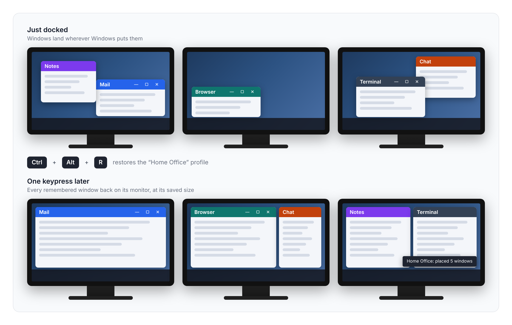
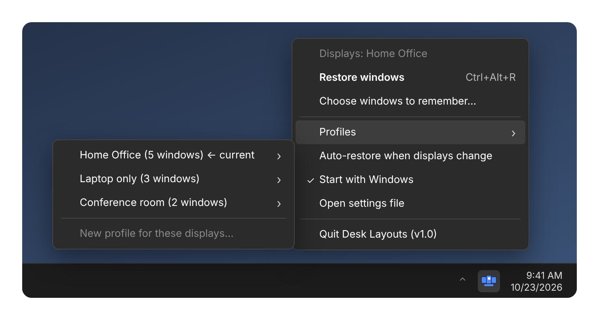
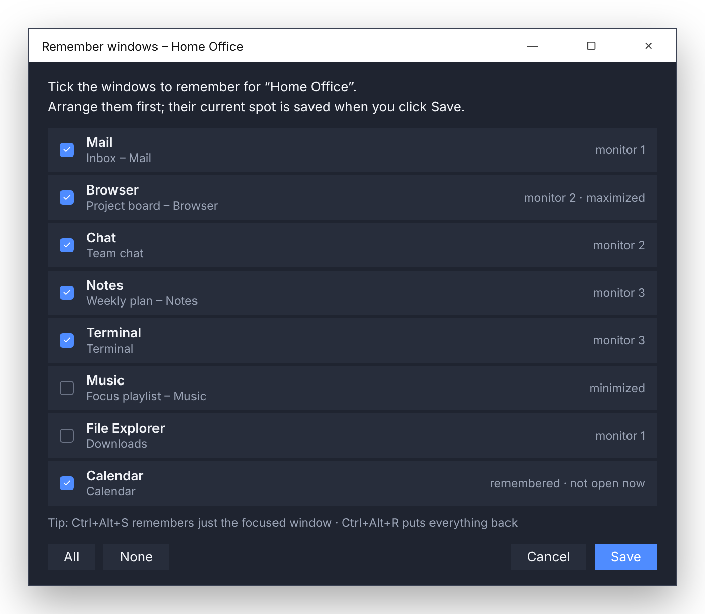

# Desk Layouts

A Windows tray app that remembers where your app windows go for each monitor setup and puts them back with a hotkey.

Plug into your home desk, the office, or just use the laptop screen: each set of connected monitors gets its own **profile**, and Desk Layouts recognizes it automatically.



<sub>Images in this README are illustrations, not screenshots.</sub>

## Features

- **Profiles per monitor setup.** Identified by the connected monitors' model and resolution, so the right profile is active as soon as you dock.
- **Choose which windows to remember.** Arrange your apps, then tick the ones to save. Position, size, monitor, and maximized state are all recorded.
- **One-key restore.** Every remembered window goes back where it belongs.
- **Smart matching.** Multiple windows from one app (e.g. two Chrome windows) are told apart by title.
- **Optional auto-restore** a few seconds after the displays change.
- **Start with Windows** toggle in the tray menu.

## Hotkeys

| Hotkey | Action |
| --- | --- |
| `Ctrl+Alt+R` | Restore every remembered window for the current profile |
| `Ctrl+Alt+S` | Remember the focused window's current position |

Left-click the tray icon to restore; right-click for windows, profiles and settings. Hotkeys can be changed in the settings file (tray → *Open settings file*), then restart the app.



## Setup

Requires Windows 10/11 and Python 3.10+.

```powershell
pip install -r requirements.txt
```

Then double-click `desk_layouts.pyw`. The `.pyw` extension runs it without a console window.

**Tip:** Run it from your cloned repo folder (e.g. `C:\Dev\DeskLayouts`) before turning on *Start with Windows*. The startup entry points at the file's exact path, and updating is then just a `git pull`.

## Usage

1. Right-click the tray icon → **Choose windows to remember…**
2. The first time on a new monitor setup, name the profile (e.g. "Home Office").
3. Tick the windows you want, then **Save**.
4. Later, press `Ctrl+Alt+R` to put everything back.



## Data

Profiles and settings are stored in `%APPDATA%\DeskLayouts\settings.json`.

## Known limitations

- Windows belonging to apps running as administrator can't be moved by a normal app.
- Minimized windows can't be saved (their position isn't known); restore them first.

## License

GPL-3.0. See [LICENSE](LICENSE).
